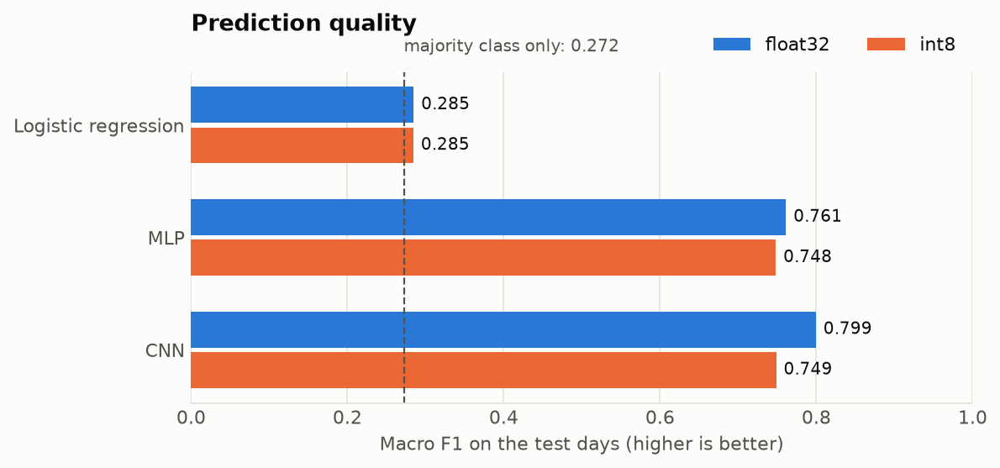
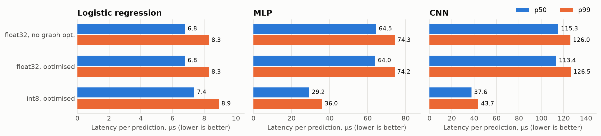

# lob-price-prediction

Mid-price direction (up / flat / down) from a limit order book, trained in
PyTorch, then run from C++ and timed. Dataset is
[FI-2010](https://arxiv.org/abs/1705.03233): 10 trading days, 5 Nasdaq Nordic
stocks, 10 book levels.

Three models: logistic regression, an MLP and a small 1-D CNN. Each is exported
to ONNX, quantised to int8 and benchmarked with ONNX Runtime. The int8 CNN is
also written out by hand in integer-only C++ (`cpp/include/lob/fixed_net.hpp`)
and checked bit-for-bit against the runtime.

Numbers below come from `make all` and are stored in `results/`.

## Accuracy

Input is the last 100 book snapshots (40 values each), target is the move over
the next 10 events. Train on days 1-7, validate on day 8, test on days 9-10.

| Model | Params | Macro F1 | Accuracy | F1 up / flat / down |
|---|---:|---:|---:|---|
| majority class | – | 0.272 | 0.690 | 0.00 / 0.82 / 0.00 |
| logistic regression, last snapshot | 123 | 0.285 | 0.690 | 0.01 / 0.82 / 0.03 |
| MLP, flattened window | 1,040,899 | 0.761 | 0.844 | 0.70 / 0.90 / 0.69 |
| CNN | 154,051 | 0.799 | 0.864 | 0.75 / 0.91 / 0.74 |



69% of the test labels are "flat", so accuracy is useless here and I report
macro F1. Logistic regression sees one snapshot and learns nothing beyond the
class prior. Anything that works needs the history.

## Latency

C++, ONNX Runtime 1.31, one thread, batch 1, Apple M3 plugged in. 20k timed
calls after 2k warm-up, median of three runs.

| Model | | p50, µs | p99, µs | windows/s at batch 64 | Macro F1 |
|---|---|---:|---:|---:|---:|
| logistic regression | float32 | 6.8 | 8.3 | 309,006 | 0.285 |
| | int8 | 7.4 | 8.9 | 307,326 | 0.285 |
| MLP | float32 | 64.0 | 74.2 | 45,725 | 0.761 |
| | int8 | 29.2 | 36.0 | 109,022 | 0.748 |
| CNN | float32 | 113.4 | 126.5 | 9,402 | 0.799 |
| | int8 | 37.6 | 43.7 | 36,717 | 0.749 |



int8 gives 2.2x on the MLP and 3.0x on the CNN. The CNN pays 5 points of F1 for
it and lands on the same score as the int8 MLP, which is faster, so after
quantisation the MLP wins. I have not tried quantisation-aware training.

Turning ONNX Runtime graph optimisations off changes nothing measurable (third
row per model in the figure). No GPU, CoreML or multi-threaded runs.

Logistic regression at ~7 µs is mostly the normalisation pass over the 100x40
window plus call overhead. At batch 64 it costs 3.2 µs per window.

## Fixed-point CNN

`fixed_net.hpp` runs the int8 CNN with int8 activations, int32 accumulators and
multiply-and-shift rescaling. Floats are used only to normalise and quantise
the input. All five layers are the same conv loop; the two dense layers are
convs with a kernel as long as the remaining time axis.

`lob_fixed` compares its logits with ONNX Runtime's on 2,000 test windows:
2,000 / 2,000 identical, max difference 0 LSB.

| int8 CNN | p50, µs | p99, µs |
|---|---:|---:|
| ONNX Runtime | 37.6 | 43.7 |
| fixed_net.hpp | 73.9 | 82.1 |

It is scalar code and about 2x slower than the runtime's SIMD kernels. I wrote
it as a reference to test hardware against, and did not optimise it. One
prediction is 4,106,432 multiply-accumulates, 2,734,080 of them in the first
conv.

There is no RTL or HLS in this repo.

## Things that mattered

Prices have to be fed relative to the current mid. Z-scoring raw prices mixes
five stocks at different price levels and buries one-tick moves; the MLP got
0.46 that way and the CNN did not train. The centring is done inside the model
(`Normalizer` in `lob/models.py`), so the ONNX graph takes the raw book.

The first conv kernel has to be longer than the horizon. With kernel 5 the CNN
sat around 0.65; kernel 12 gave 0.80.

int8 calibration needs clipping. Book sizes are heavy-tailed, and min/max
calibration took the MLP to 0.40. I use the 99.9th percentile. The
normalisation itself stays in float32: a tick is ~0.04% of the price, which
does not fit in 8 bits before centring.

The 0.46 / 0.65 / 0.40 figures are from throwaway runs and are not reproduced
by `make all`.

## Caveats

- While trying normalisations and kernel sizes I was printing the test score
  next to the validation score, so the test days are not untouched. Val and
  test agree (0.806 / 0.799 for the CNN).
- One seed.
- Day 8 is my validation set, so the test split is not the usual days 8-10 and
  the scores are not comparable with papers.
- FI-2010 labels come precomputed from a smoothed mid-price. None of this says
  anything about PnL.
- Files concatenate stocks; about 1% of val/test windows cross a stock or day
  boundary. Not filtered.
- Laptop timings. On battery everything was ~1.75x slower (CNN int8 p50 65 µs);
  ratios between variants did not change. p99 moves by tens of percent between
  runs.
- Only the model call is timed, not building the window from a feed.

## Build and run

Python 3.10+, CMake 3.20+, a C++20 compiler. Developed on macOS arm64; CI
builds and runs the tests on Linux. Benchmarks were only run on the Mac.

```bash
make setup    # venv + python deps
make all      # train, export, build, bench, plots (~10 min)
make test
```

First run downloads FI-2010 (56 MB) and a prebuilt ONNX Runtime.

| Target | Output |
|---|---|
| `make train` | `artifacts/*.pt`, `results/metrics.json` |
| `make export` | `artifacts/*.onnx`, `artifacts/cnn.fixed.bin`, `results/export.json` |
| `make build` | `build/lob_bench`, `build/lob_fixed`, `build/lob_tests` |
| `make bench` | `results/latency.json`, `results/fixed_point.json` |
| `make plots` | `results/*.png` |

## Layout

```
lob/
  data.py           download, parsing, split, windowing
  models.py         normaliser, logreg, MLP, CNN
  train.py          training loop, early stopping
  evaluate.py       predictions over a split, metrics
  export.py         ONNX export, int8 quantisation
  export_fixed.py   integer tables + test vectors for fixed_net.hpp
  bench.py          drives lob_bench over all models
  plots.py          figures
cpp/
  src/bench.cpp           ONNX Runtime latency benchmark
  src/fixed_bench.cpp     checks and times the fixed-point CNN
  include/lob/            fixed_net.hpp, latency_stats.hpp, samples.hpp
  tests/
tests/              pytest
results/            json + png
```
